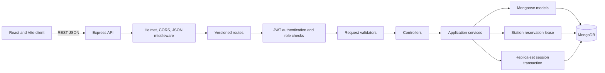

# System architecture

## Components

- **React client:** Vite, TypeScript, and Tailwind CSS provide the branded home page and API-connected account, station, booking, wallet, notification, and admin screens. The home page layout and styling remain the visual reference.
- **Express API:** CommonJS modules mount versioned health, authentication, station, booking, wallet, notification, and admin routes. Helmet, CORS, JSON parsing, and centralized error handling are configured in the application.
- **Middleware:** Authentication verifies JWTs and reloads the current user; role middleware protects admin routes; validators normalize and reject invalid inputs.
- **Controllers and services:** Controllers map HTTP requests and responses. Services implement authentication, station, booking, wallet, notification, and admin overview rules. Wallet and booking services coordinate financial and notification writes through MongoDB sessions.
- **Mongoose and MongoDB:** Models store users, stations, bookings, wallets, transactions, notifications, and the supporting station reservation lease.

## Request and response flow

1. Express parses JSON and applies security middleware.
2. A route applies authentication and, where required, admin authorization.
3. Validators check IDs, fields, timestamps, filters, and pagination.
4. A controller calls a service and returns a status code with a JSON envelope.
5. Services query or update Mongoose models. Wallet balance, ledger, booking payment/refund state and related notifications commit inside one MongoDB session transaction. Booking creation and its admin notification also commit together. Errors are passed to centralized error handling.

The client API layer reads `VITE_API_BASE_URL` and defaults to `http://localhost:5000/api/v1`. It sends bearer tokens for protected requests, normalizes API errors, and clears expired sessions on authentication failures. User and admin route guards rely on the loaded profile role; the backend remains authoritative for access control.

## Authentication flow

Registration normalizes the email, hashes the password, creates a user with the `user` role, and creates the user's wallet. Login verifies the hash and returns an HS256 JWT with the configured expiry. Protected requests require a bearer token; middleware verifies it, loads the current user, rejects blocked accounts or changed roles, and sets the authenticated user ID and role for downstream handlers.

Logout is expiry-based. The API tells the client to discard its token but does not maintain a revocation list; a copied token remains valid until it expires or the account becomes blocked.

## Booking concurrency and financial transactions

Booking creation acquires a MongoDB-backed lease with one unique lock record per station. Acquisition uses an insert protected by the unique station index, or an atomic takeover if the existing lease has expired. The booking service rechecks station status and time overlap while holding the lease, saves the booking, then releases only the lease with its own token.

If a process exits unexpectedly, the lease becomes reclaimable after `BOOKING_LOCK_TTL_MS`. An expired record is replaced on the next reservation attempt. Availability reports a live lease as `reservation_in_progress`. Integration tests issue concurrent requests against local MongoDB and verify that only one overlapping request succeeds.

Direct database writes bypass application-level booking leases and ledger policy. Booking creation and wallet changes require a MongoDB replica set named `rs0`. Top-ups, booking charges, eligible cancellation refunds, admin adjustments, and booking creation use `withTransaction` with snapshot reads and majority writes. A balance update, its unique-reference transaction record, and (for bookings) booking/payment/refund state and notifications commit or roll back together. Conditional balance updates protect against negative balances and safe-integer overflow; unique transaction references make operations idempotent. The MongoDB driver retries transient transaction errors. There is no non-transactional fallback.

Top-ups and admin adjustments require an `Idempotency-Key`; keys are hashed into unique transaction references and reused keys must match the original operation. Booking charges and refunds use deterministic references derived from the booking ID. Concurrent transactions against one wallet conflict and retry against the committed balance, so competing charges cannot both spend the same funds.

The simulated top-up does not contact a payment processor, and this academic wallet is not a real-money payment system.

## Notifications and administration

Notification routes require authentication and derive the recipient from the verified account. The service scopes every list, read and unread-count operation to that user. A unique event reference per recipient makes event writes idempotent. Booking-created admin notifications share a transaction with the booking insert; wallet, payment, cancellation and refund notifications share the financial transaction that changes their ledger and booking state. Notification persistence failures therefore roll back the associated operation rather than leaving an unannounced financial change.

The admin overview uses database aggregations for station and booking status counts and returns recent bookings plus the current administrator's operational notifications. The navbar refreshes unread counts on route changes, window focus, panel open, and explicit refresh events after account actions. No polling or external notification delivery is used.

## Important technical decisions

- Booking times require an explicit ISO 8601 offset and are stored as UTC `Date` values. Client display defaults to `Asia/Kolkata`.
- Booking start dates are limited by the backend to today and the next two calendar days in `Asia/Kolkata`; the client date controls mirror this rule.
- Reservation intervals are half-open: `[startAt, endAt)`. An end time equal to another booking's start time is allowed.
- Session duration defaults to 30-minute increments, minimum 30 minutes, maximum 12 hours. These values are environment-configurable.
- Prices are stored in integer paise. The server uses the station rate snapshot and rounds a fractional paise upward; no discounts are applied.
- New bookings start as `pending` and `unpaid`. Pending and confirmed bookings block overlapping reservations. A successful wallet charge sets the booking to `confirmed` and `paid`.
- Cancellation is allowed before the session starts for pending or confirmed bookings. It preserves the booking record; a paid booking is refunded to its wallet within the same transaction, while an unpaid booking is cancelled without a refund.
- Booking prices are charged from `priceSnapshot.totalMinor`; client-provided prices are not accepted.
- A zero-price booking can be confirmed with `paymentStatus: not_required`; it creates no wallet or ledger entry and is never refunded.
