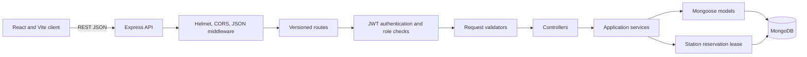

# System architecture

## Components

- **React client:** Vite, TypeScript, and Tailwind CSS render the current lounge home-page prototype. The client does not yet call the backend.
- **Express API:** CommonJS modules mount versioned health, authentication, station, and booking routes. Helmet, CORS, JSON parsing, and centralized error handling are configured in the application.
- **Middleware:** Authentication verifies JWTs and reloads the current user; role middleware protects admin routes; validators normalize and reject invalid inputs.
- **Controllers and services:** Controllers map HTTP requests and responses. Services implement authentication, station, and booking rules.
- **Mongoose and MongoDB:** Models store users, stations, bookings, wallets, transactions, notifications, and the supporting station reservation lease.

## Request and response flow

1. Express parses JSON and applies security middleware.
2. A route applies authentication and, where required, admin authorization.
3. Validators check IDs, fields, timestamps, filters, and pagination.
4. A controller calls a service and returns a status code with a JSON envelope.
5. Services query or update Mongoose models. Errors are passed to centralized error handling.

## Authentication flow

Registration normalizes the email, hashes the password, creates a user with the `user` role, and creates the user's wallet. Login verifies the hash and returns an HS256 JWT with the configured expiry. Protected requests require a bearer token; middleware verifies it, loads the current user, rejects blocked accounts or changed roles, and sets the authenticated user ID and role for downstream handlers.

Logout is expiry-based. The API tells the client to discard its token but does not maintain a revocation list; a copied token remains valid until it expires or the account becomes blocked.

## Booking concurrency and standalone MongoDB

The configured local MongoDB is standalone, so booking creation does not rely on multi-document transactions. The booking service acquires a MongoDB-backed lease with one unique lock record per station. Acquisition uses an insert protected by the unique station index, or an atomic takeover if the existing lease has expired. The booking service rechecks station status and time overlap while holding the lease, saves the booking, then releases only the lease with its own token.

If a process exits unexpectedly, the lease becomes reclaimable after `BOOKING_LOCK_TTL_MS`. An expired record is replaced on the next reservation attempt. Availability reports a live lease as `reservation_in_progress`. Integration tests issue concurrent requests against local MongoDB and verify that only one overlapping request succeeds.

This protects booking writes that use the booking API and finish within the configured lease. Direct database writes bypass the lease, and a process paused longer than the lease is outside this guarantee. A replica-set deployment with transactions would provide stronger multi-document atomicity.

## Important technical decisions

- Booking times require an explicit ISO 8601 offset and are stored as UTC `Date` values. Client display defaults to `Asia/Kolkata`.
- Reservation intervals are half-open: `[startAt, endAt)`. An end time equal to another booking's start time is allowed.
- Session duration defaults to 30-minute increments, minimum 30 minutes, maximum 12 hours. These values are environment-configurable.
- Prices are stored in integer paise. The server uses the station rate snapshot and rounds a fractional paise upward; no discounts are applied.
- New bookings start as `pending`. Pending and confirmed bookings block overlapping reservations. Payment and confirmation behavior belong to Milestone 6.
- Cancellation is allowed before the session starts for pending or confirmed bookings. It preserves the booking record and does not issue a refund.
